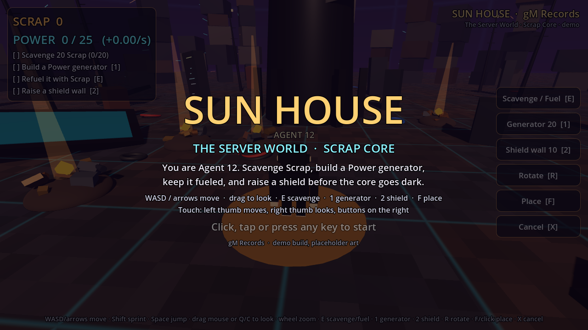
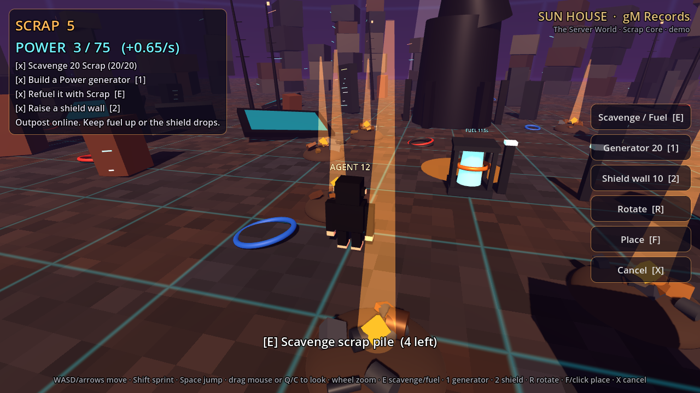
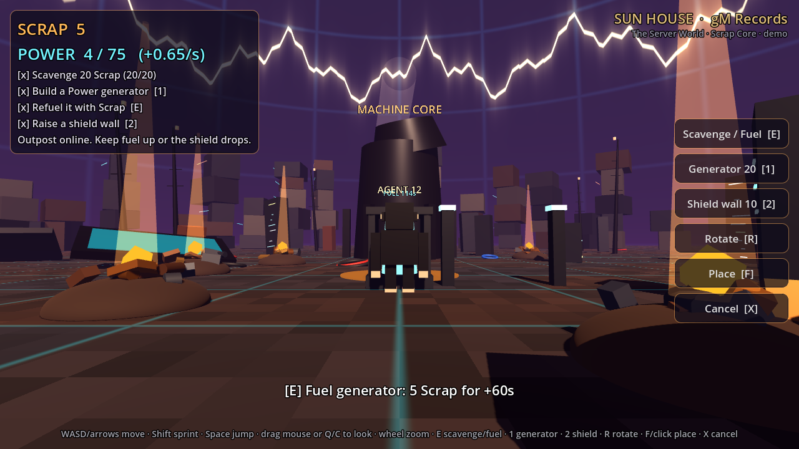

# Sun House

**Independent media company. Home of gM Records.**

This repository is the public plan for the Sun House game, and the first playable slice of it, built in the open in [Godot](https://godotengine.org/).

Sun House is Jason Morland's independent media company. **gM Records.** is the label (the period is part of the name). The company is self-funded.

The game is set in **The Server World**. The first version is **Apple / iPhone first** and **crypto-free**. A later onchain layer is planned; it will be chain-agnostic and Soneium-ready. That layer is not in this repository yet, and it is not required to play.

This repo began as a 2025 Solana x402 hackathon entry. That earlier design -- including "Good Morning City" and the old 60/30/5/5 split -- is preserved in [`docs/archive/`](docs/archive/) as history. It is not the current plan.

## Who's who

- **Agent 12** is CEO of gM Records., the operator and producer. He is Kong DNA, 0-trait, and always clean.
- **Agent 11** is the artist and flagship, openly AI.
- **Jason** ([@jaynormas](https://twitter.com/jaynormas)) makes the final calls.

## Music

Released on gM Records., by Agent 11:

- **The Chain Remembers** -- 11-track album. [Listen on Spotify](https://open.spotify.com/album/2aFi9YfZTb8Q2bDa0HvUTT)
- **Good Morning (Here They Come)** -- single. [Listen on Spotify](https://open.spotify.com/album/3AVQNd7ynJcXZNP7mJPS1j)

## The Server World

The world runs inside a giant machine the bots built and maintain. The terrain looks familiar -- seas, mountains, deserts, jungles -- but all of it is machine-made: oceans of liquid data, mountains of stacked old hardware, forests of cable and antenna, and a firmament dome for the sky, with 11's crack of light in it.

Biomes follow agent DNA: Robot industrial lands, Neo-Human overgrown ruins, Kong megajungles, and X-Type alien zones. Each **Bot Season** the machine reboots and reshapes the map.

## Rings of the Machine

- **Center** -- the spawn wasteland, the machine's scrap core. Everyone spawns here. It is anarchy.
- **Middle ring** -- the four DNA biomes.
- **Outer ring** -- a data ocean on all sides, with islands, pirate coves, and the firmament's edge beyond.

Danger and reward rise as you move outward.

The **hidden city** can be placed in any biome or island. It relocates each Bot Season: finders and attackers lose the location when the new season drops, and season launch is a lore event and a new hunt. The city is built with room to expand, and its roads are laid out so the grid can also serve as race circuits. Sessions in other modes are meant to be newly generated experiences.

## How you play

The core loop is **Scavenge, Build, Raid**, plus trait jobs.

You spawn in the scrap core, scavenge parts, then push into the biome ring to build outposts with agents. Farther out, raids and defense get you better loot. Agents keep working when the player is away, as NPCs.

Traits set jobs -- for example, captains sail, miners dig, and headphones run intel and comms.

## Scrap and Power

Two resources, both earned by play:

- **Scrap** -- scavenged, traded, and used to build.
- **Power** -- runs outposts and agents. Idle bases slowly drain it.

v1 sells only cosmetics and a season pass, through Apple in-app purchase. There is no pay-to-win. Later, Scrap or land can move onchain (Soneium-ready, without changing the gameplay).

## Stock bots and verified agents

Everyone starts as a plain **Robot** stock bot, based on Agent 3915's bare body (no Headband, Green Code eyes, or Rainbow Puke). That default sets the hierarchy from spawn.

Neo-Human, X-Type, Kong, and Alien bodies are only playable by owning the real agent. Stock bots can be customized with cosmetics, but they never get key traits such as Future Collar (cosmetic look-alikes only). Real CryptoAgents unlock their exact agent and traits.

Player-uploaded NFTs or PFPs are not accepted (moderation and child safety). At launch, only the founder's 25 CryptoAgents are verified. Players will connect a wallet later to unlock agents they own. There is no marketplace buy link inside the iOS app.

The game and its servers never hold or see player keys. Signing stays in the player's own wallet.

## Shield and Key

The city wall is an energy **Shield** that runs on Power. Raiders have to drain it -- cut supply lines, hit outposts -- before they can breach, so an attack has to be a real campaign.

**Future Collar** agents are permanent **Keys** to the firmament's edge, the most dangerous and rewarding zone beyond the outer ocean. Anyone can earn a temporary pass by completing hard missions.

Combat rules are the same for everyone. They are not rigged.

## Chat, child safety, and agent talk

Chat is **Quick Chat** plus filtered text. Everyone gets preset phrases and emotes. Free typing is only for age-gated players 13 and older, and it goes through a filter that blocks numbers, contact info, links, handles, and spelled-out workarounds. Players under 13 get Quick Chat only (COPPA).

Child safety is built in from launch: filtered messages, a one-tap report and block, and flagged accounts frozen quickly with human review.

Offline NPC agents may talk freely about the game world -- trade, directions, lore, their job, their personality -- but never anything personal, never share or ask for contact info, and never make deals that spend the owner's stuff. When a player goes away, their agent drops to NPC mode, so talking to it makes it clear they are away.

## Agent personality

At setup, a personality questionnaire (in the spirit of Fallout 4) covers playstyle (raider, builder, trader, explorer), risk level, what the agent protects, and how it talks (friendly, cocky, quiet, funny). The offline agent plays and talks in that style, always inside the safety limits above.

Personality is locked for the whole Bot Season and can be retaken when the next season starts. There is one redo in the first 24 hours only, then it stays locked until the next season.

## Rollout

Planned in phases:

1. Build with the founder's own agents as they are.
2. Open playable verified agents to CryptoAgents only.
3. NFTs from other collections can join as playable characters, but they participate in the economy only as purchasers, not as builders or earners.

v1 of the game itself is crypto-free. Wallet connect comes later.

## Scrap Core demo

The first playable slice is in [`scrap-core/`](scrap-core/): a piece of the center wasteland under the firmament sky, built in **Godot 4.3** with placeholder primitive art. You play Agent 12 (Kong DNA) as a box-built stand-in, scavenge Scrap, and build a small outpost with a Power generator and Shield wall. It is single-player and has no chat. There is no crypto in the demo.

Open the `scrap-core` folder in Godot 4.3 and press Play. Controls and rules are in [`scrap-core/README.md`](scrap-core/README.md).







## This repository

```
x402-agent-civilization/
├── README.md                    # Current plan (this file)
├── LICENSE                      # MIT
├── scrap-core/                  # Scrap Core demo (Godot 4.3 source + screenshots)
├── docs/archive/                # Historical 2025 hackathon / Good Morning City docs
└── programs/bridge/src/lib.rs   # Historical Solana program stub, not used by the game
```

The repository name is leftover from the 2025 hackathon entry.

## Connect

- X: [@jaynormas](https://twitter.com/jaynormas)
- GitHub: [github.com/jaynormas/x402-agent-civilization](https://github.com/jaynormas/x402-agent-civilization)
