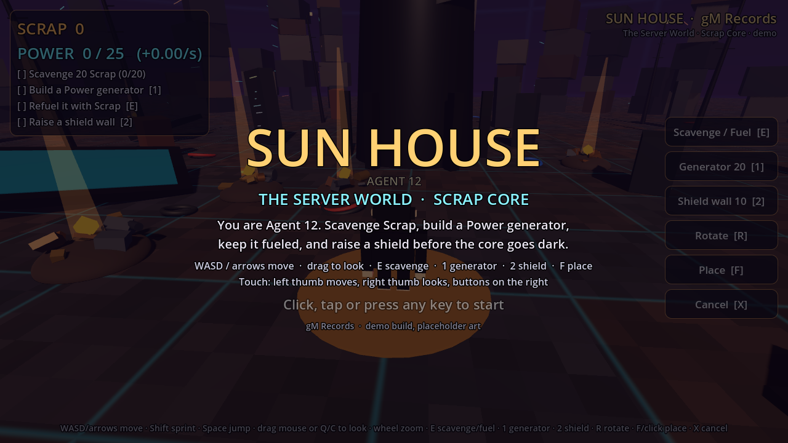
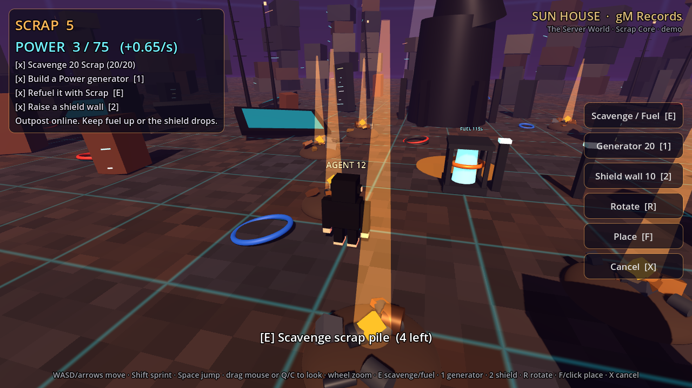
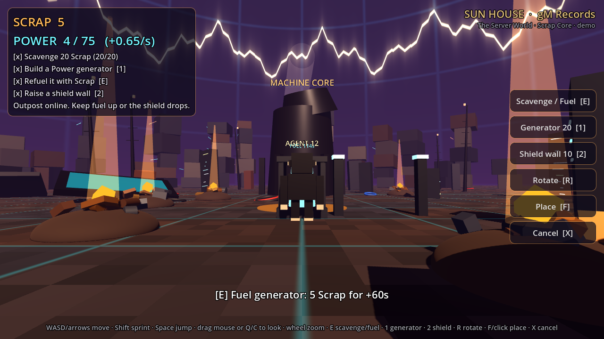

# Sun House: Scrap Core demo (Godot 4.3)

First playable slice of The Server World: the center spawn wasteland (the machine's scrap core) under the firmament dome, with 11's crack of light in the sky. You play Agent 12 (Kong DNA, 0 traits) as a placeholder bot built from boxes.

Placeholder primitive art only. No crypto, no NFTs, no generated assets. Free/open-source tools only.

## Play
Open this folder in Godot 4.3 (free, [godotengine.org](https://godotengine.org/)) and press Play. This repository includes the source and screenshots only.

## Screenshots




## Controls
| Action | Keyboard / mouse | Touch |
|---|---|---|
| Move | WASD or arrows | left thumb (virtual stick) |
| Look | drag mouse (left or right button), Q / C | right thumb drag |
| Zoom | mouse wheel | none |
| Sprint / jump | Shift / Space | none |
| Scavenge pile, or fuel a generator | E | Scavenge / Fuel button |
| Build Power generator (20 Scrap) | 1 | Generator button |
| Build Shield wall (10 Scrap) | 2 | Shield wall button |
| Rotate build | R | Rotate button |
| Place build | F, Enter or left click | Place button |
| Cancel build | X or Esc | Cancel button |

## Rules in the demo
- 16 scrap piles (orange beacons). Each gives 5 Scrap per hit, 4 hits, then regrows after 25 s.
- Power generator: costs 20 Scrap, comes with 60 s of fuel, makes +1 Power/s while fueled. Feed it 5 Scrap (E) for +60 s (tank max 180 s). Each generator adds +50 to the Power cap.
- Shield wall: costs 10 Scrap, drains 0.25 Power/s. At 0 Power the field turns off and you can walk through it; under 5 Power it flickers.
- Idle drain: every structure drains 0.05 Power/s. If you stop fueling, the base goes dark (Scrap and Power lock).
- Objectives checklist in the HUD walks through the loop.

## Files
- `project.godot`, `main.tscn` (one node), `main.gd` (builds the whole world, player, HUD and rules in code), `export_presets.cfg` (Web preset, threads off).
- Self-test: `godot --path . -- --autotest` plays the loop automatically, prints results and saves screenshots to Godot's user:// folder.

## Web export (optional, not in this repository)
```
godot --headless --path . --import
godot --headless --path . --export-release "Web" ../scrap-core-web/index.html
```
Needs Godot 4.3 export templates (official download).
